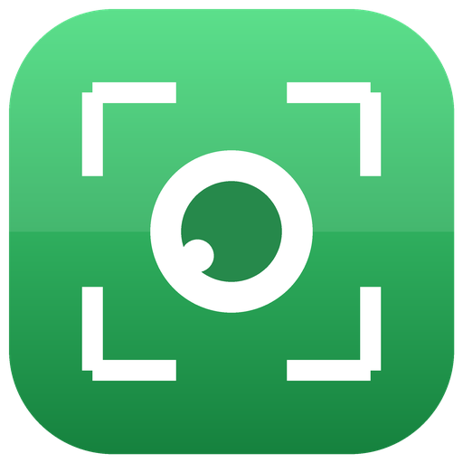

# Kodmoz Picture

macOS menü çubuğunda yaşayan, **global kısayolla ekran görüntüsü alan** küçük ama eksiksiz uygulama.
Aldığı görüntüyü **otomatik olarak panoya kopyalar**, `~/Pictures/KodmozPicture` klasörüne kaydeder
ve menü çubuğundaki simgeden **son görüntüleri küçük resimlerle** gösterir.

<p align="center">
  
</p>

## Özellikler

- **Global kısayol** (varsayılan `⌘⇧P`) — erişilebilirlik izni **gerektirmez** (Carbon `RegisterEventHotKey`)
- **Panoya otomatik kopyalama** — görüntü + dosya referansı birlikte yazılır (WhatsApp/Finder/Slack hedefleri dosyayı tanır)
- **Otomatik kayıt** — `~/Pictures/KodmozPicture/Kodmoz 2026-10-25 at 18.30.12.png` biçiminde, klasör değiştirilebilir
- **Dört yakalama modu** — tüm ekranlar (ana ekran), alan seçimi (`-i`), pencere seçimi (`-w`)
- **Menü çubuğu geçmişi** — son N görüntü küçük resimle listelenir; tıkla → Önizleme'de aç,
  alt menüden **Panoya Kopyala / Finder'da Göster / Çöp Kutusuna Taşı**
- **Bildirim** — yakalanan görüntünün küçük önizlemesiyle bildirim banner'ı
- **Ayarlar penceresi** — kısayol kaydedici, klasör seçimi, mod, pano/bildirim/ses açma-kapama, geçmiş sayısı
- **Girişte otomatik başlat** — `SMAppService` ile (LaunchAgent dosyası elle kurcalanmaz)
- **Vektörel logo** — ikon ve menü simgesi kodda `NSBezierPath` ile çizilir; harici görsel dosyası yok
- **Dock'ta görünmez** (`LSUIElement`) — sadece menü çubuğu
- **CLI** — `KodmozPicture --capture [full|selection|window]`, `KodmozPicture --make-icon <dizin>`

## Logo

| Uygulama ikonu | Menü çubuğu (koyu/açık) |
|---|---|
|  |  |

Menü simgesi **template image**'dır: sistem koyu temada beyaz, açık temada siyah çizer.

## Kurulum (macOS 13+)

```bash
git clone https://github.com/hasanislamoglu5361/kodmoz-picture.git
cd kodmoz-picture
./scripts/install.sh
```

`install.sh` şunları yapar: `swift build -c release` → ikon seti (`.icns`) → `Kodmoz Picture.app`
paketi → `/Applications` → `lsregister` + `killall Dock` → uygulamayı başlatır.

### İlk çalıştırma izni (tek sefer)

İlk kısayolda macOS **Ekran Kaydı** izni ister:

> Sistem Ayarları → Gizlilik ve Güvenlik → **Ekran Kaydı** → **Kodmoz Picture** ✓

Sonra uygulamayı bir kez kapat-aç. (Kısayol için erişilebilirlik izni **gerekmez**.)

## Kullanım

| Ne | Nasıl |
|---|---|
| Ekran görüntüsü | `⌘⇧P` (Ayarlar'dan değiştirilebilir) |
| Alan seçerek | Menü → *Alan Seçerek Al* |
| Pencere seçerek | Menü → *Pencere Seçerek Al* |
| Geçmiş | Menü çubuğu simgesi → *Son Görüntüler* |
| Klasör | Menü → *Klasörü Aç* |
| Ayarlar | Menü → *Ayarlar…* (`⌘,`) |

## Mimari

```
Sources/KodmozPicture/
  main.swift            giriş noktası + CLI (--capture / --make-icon)
  AppDelegate.swift     menü çubuğu, menü kurulumu, geçmiş, bildirim
  HotKey.swift          Carbon global kısayol (izin gerektirmez)
  CaptureEngine.swift   screencapture çağrısı, pano, dosya adlandırma, geçmiş listesi
  Preferences.swift     UserDefaults sarmalayıcısı + kısayol tanımı
  PreferencesWindow.swift  ayarlar arayüzü + kısayol kaydedici + SMAppService
  LogoRenderer.swift    vektörel logo (ikon + menü simgesi) ve .iconset üretimi
scripts/
  build.sh              .app paketi (ikon → bundle → ad-hoc imza)
  install.sh            derle + /Applications'a kur + başlat
  logo_onizleme.py      README için PNG önizleme (Swift çiziminin eşi)
```

Bağımlılık yok: yalnızca AppKit + Carbon + ServiceManagement + UserNotifications.
Ekran görüntüsü `/usr/sbin/screencapture` ile alınır (Apple'ın kendi aracı).

## Sorun giderme

- **Kısayol çalışmıyor** → başka bir uygulama `⌘⇧P`'yi kullanıyor olabilir; Ayarlar'dan başka kombinasyon seç.
- **Siyah/boş görüntü** → Ekran Kaydı izni verilmemiş; yukarıdaki adımı uygula.
- **Menü simgesi görünmüyor** → `killall SystemUIServer` veya uygulamayı yeniden başlat.
- **Bildirim çıkmıyor** → Sistem Ayarları → Bildirimler → Kodmoz Picture → *Bildirimlere izin ver*.

## Lisans

MIT — bkz. [LICENSE](LICENSE).

---

Geliştirme: [Hasan İslamoğlu](https://hasanislamoglu.com) · Kodmoz
